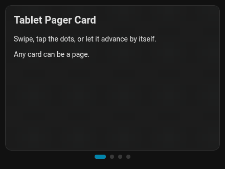
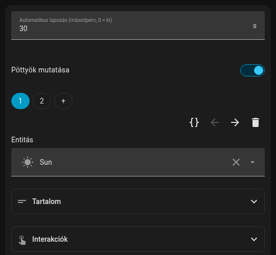

# Tablet Pager Card

[](https://hacs.xyz/docs/faq/custom_repositories)

Several Home Assistant cards in one place, gliding into each other. Swipe with a finger or the mouse, tap the dots, or let it advance by itself. Built for wall tablets, works anywhere.

*[Magyar leírás lent ↓](#magyarul)*



## Features

- **Swipe** left / right, the page follows the finger. Past 18 % of the width it pages, otherwise it slides back.
- **Taps stay taps.** A swipe only starts after 12 px of mostly horizontal movement, so buttons on the pages keep working, and vertical scrolling of the dashboard is never blocked.
- **No accidental toggles.** The click that a browser may send at the end of a swipe is swallowed, so swiping across a light tile does not switch the light.
- **Automatic paging** every `interval` seconds. Any touch restarts the timer, so the page never slides away under your hand. Paused while the browser tab is hidden.
- **Wrap-around:** after the last page comes the first one.
- **Any card** can be a page, built-in or custom.
- **Hidden pages:** if an inner card sets `paused = true` on itself (for example an irrigation card out of season), its page and dot disappear.
- **Visual editor:** set the interval and dots, add, reorder, delete and edit the inner cards without YAML.

  

- No dependencies, one small file. Hungarian config keys work too.

## Installation

### HACS (recommended)

1. HACS → ⋮ → **Custom repositories** → URL `https://github.com/Gyuszko55/tablet-pager-card`, type **Dashboard**.
2. Search for **Tablet Pager Card** and download it.
3. Reload the browser (on a wall tablet: reload the start page or clear the cache).

### Manual

1. Copy `tablet-pager-card.js` to `/config/www/tablet-pager-card.js`.
2. Settings → Dashboards → ⋮ → **Resources** → add `/local/tablet-pager-card.js` as **JavaScript module**.

## Configuration

| Key | Default | Description |
|---|---|---|
| `cards` | (required) | List of cards, one per page. |
| `interval` | `30` | Seconds between automatic page changes. `0` turns it off. |
| `show_dots` | `true` | Show the page dots under the card. |

```yaml
type: custom:tablet-pager-card
interval: 30
cards:
  - type: tile
    entity: light.kitchen
  - type: weather-forecast
    entity: weather.home
  - type: picture-glance
    camera_image: camera.front_door
    entities: []
```

**Height:** in a normal view the pager is as tall as its tallest page, so the dashboard does not jump when paging. In a fixed-height container (sections view with `grid_options: rows: …`, grid layout, custom panel) it fills the cell.

### Hiding a page from your own card

```js
// inside your custom card
get paused() { return this._outOfSeason; }
```

The pager checks `paused` on every state update.

---

## Magyarul

Több Home Assistant kártya egy helyen, egymást átúsztatva. Ujjal vagy egérrel oldalra húzva lapozható, a pöttyökre koppintva ugrik, és magától is továbblép. Fali tablethez készült, de bárhol használható.

**Tudja:**

- **Húzás:** a lap követi az ujjat. Ha a mozdulat a szélesség 18%-ánál nagyobb, lapoz, különben visszaúszik.
- **A koppintás koppintás marad:** csak 12 képpontnyi, főleg vízszintes mozdulat után indul a húzás, így a lapokon lévő gombok működnek, és a vezérlőpult függőleges görgetése sem akad el.
- **Nem kapcsol véletlenül:** a húzás végén érkező kattintást elnyeli, így egy lámpa-csempén áthúzva nem kapcsol fel a lámpa.
- **Automatikus lapozás** `valtas_mp` (vagy `interval`) másodpercenként. Érintéskor a számláló újraindul, így nem úszik el a lap a kezed alól. Rejtett böngészőfülön szünetel.
- **Körbeér:** az utolsó után az első jön.
- **Bármilyen kártya** lehet egy lap, gyári és egyedi is.
- **Rejtett lap:** ha egy belső kártya `paused` (vagy `szunetel`) tulajdonsága igaz, például öntözés szezonon kívül, a lapja és a pöttye eltűnik.
- **Vizuális szerkesztő:** lapozási idő, pöttyök, belső kártyák hozzáadása, sorrendje, törlése és szerkesztése YAML nélkül.

**Telepítés HACS-ből:** HACS → ⋮ → **Egyéni tárolók** → cím: `https://github.com/Gyuszko55/tablet-pager-card`, típus: **Dashboard** → letöltés → böngésző újratöltése.

**Beállítás** (a magyar és az angol kulcsok egyaránt működnek):

| Kulcs | Angolul | Alapérték | Leírás |
|---|---|---|---|
| `kartyak` | `cards` | (kötelező) | A kártyák listája, laponként egy. |
| `valtas_mp` | `interval` | `30` | Automatikus lapozás másodpercben, `0` = kikapcsolva. |
| `pottyok` | `show_dots` | `true` | Pöttyök mutatása a kártya alatt. |

```yaml
type: custom:tablet-pager-card
valtas_mp: 30
kartyak:
  - type: tile
    entity: light.konyha
  - type: weather-forecast
    entity: weather.otthon
```

## License

MIT
