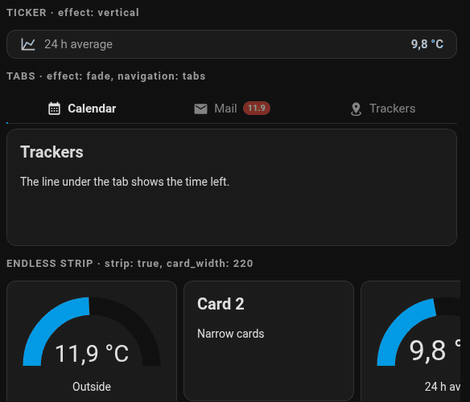

# Tablet Pager Card

[](https://hacs.xyz/docs/faq/custom_repositories)
[](https://github.com/Gyuszko55/tablet-pager-card/actions/workflows/validate.yml)

Several Home Assistant cards in one place, paging by themselves. Four ways to use it: pages that **slide** in (swipe or tap the dots), an **endless strip** of narrow cards, **tabs** with a progress line, and a vertical **ticker** of entity rows. Built for wall tablets, works anywhere.

*[Magyar leírás lent ↓](#magyarul)*




## Features

| Mode | Settings | Typical use |
|---|---|---|
| Slide | `effect: slide` (default) | rooms, lights, irrigation… one card at a time |
| Endless strip | `strip: true`, `card_width: 220` | narrow cards side by side, as many as the width allows (the last one partly); steps left, the card that leaves joins the end, after the last card the first comes again |
| Tabs | `effect: fade`, `navigation: tabs` | calendar / mail / trackers: a tab bar, the line under the active tab shows the time left, optional badge |
| Ticker | `effect: vertical` | name day, exchange rate, fuel price: rows roll upwards, tap opens the history |


- **Swipe** left / right, the page follows the finger. Past 18 % of the width it pages, otherwise it slides back.
- **Taps stay taps.** A swipe only starts after 12 px of mostly horizontal movement, so buttons on the pages keep working, and vertical scrolling of the dashboard is never blocked.
- **No accidental toggles.** The click that a browser may send at the end of a swipe is swallowed, so swiping across a light tile does not switch the light.
- **Automatic paging** every `interval` seconds. Any touch restarts the timer, so the page never slides away under your hand. Paused while the browser tab is hidden.
- **Wrap-around:** after the last page comes the first one.
- **Any card** can be a page, built-in or custom.
- **Hidden pages:** if an inner card sets `paused = true` on itself (for example an irrigation card out of season), its page and dot disappear.
- **Visual editor:** set the interval and dots, add, reorder, delete and edit the inner cards without YAML.

  

- No dependencies, one small file. Hungarian config keys work too.

## Installation

### HACS (recommended)

1. HACS → ⋮ → **Custom repositories** → URL `https://github.com/Gyuszko55/tablet-pager-card`, type **Dashboard**.
2. Search for **Tablet Pager Card** and download it.
3. Reload the browser (on a wall tablet: reload the start page or clear the cache).

### Manual

1. Copy `tablet-pager-card.js` to `/config/www/tablet-pager-card.js`.
2. Settings → Dashboards → ⋮ → **Resources** → add `/local/tablet-pager-card.js` as **JavaScript module**.

## Configuration

| Key | Default | Description |
|---|---|---|
| `cards` | (required) | List of cards, one per page. |
| `interval` | `30` | Seconds between automatic page changes. `0` turns it off. |
| `effect` | `slide` | `slide`, `fade` or `vertical`. |
| `navigation` | `dots` (`none` with `vertical`) | `dots`, `tabs` or `none`. |
| `strip` | `false` | Endless strip (only with `slide`). |
| `card_width` | the card's own width | Strip: width of one card in px. Without it each card keeps its own width (for cards that have one; most built-in cards fill the available space, so set it for those). |
| `tabs` | | With `navigation: tabs`: one entry per card, in the same order: `name`, `icon`, `badge` (an entity; shown when not 0 / off). |
| `show_dots` | `true` | Older switch for the dots; `false` is the same as `navigation: none`. |

```yaml
type: custom:tablet-pager-card
interval: 30
cards:
  - type: tile
    entity: light.kitchen
  - type: weather-forecast
    entity: weather.home
  - type: picture-glance
    camera_image: camera.front_door
    entities: []
```

**Height:** in a normal view the pager is as tall as its tallest page, so the dashboard does not jump when paging. In a fixed-height container (sections view with `grid_options: rows: …`, grid layout, custom panel) it fills the cell.

### Endless strip

```yaml
type: custom:tablet-pager-card
interval: 6
strip: true
card_width: 220
navigation: none
cards:
  - type: tile
    entity: climate.living_room
  - type: tile
    entity: climate.bedroom
  - type: gauge
    entity: sensor.outside_temperature
  - type: tile
    entity: lock.front_door
```

As many cards are shown as the width allows, the last one partly. The strip steps by the width of the leading card, so cards of different widths can be mixed. The card that leaves is moved to the end, so each card normally runs only once. When there are too few cards to fill the width, copies of the set are added (only as many as needed, recounted when the width changes), so after the last card the first one comes again.

### Tabs

```yaml
type: custom:tablet-pager-card
interval: 20
effect: fade
navigation: tabs
tabs:
  - { name: Calendar, icon: mdi:calendar-month }
  - { name: Mail, icon: mdi:gmail, badge: sensor.gmail_unread }
  - { name: Trackers, icon: mdi:map-marker-radius }
cards:
  - type: calendar
    entities: [calendar.family]
  - type: markdown
    content: "{{ states('sensor.gmail_unread') }} unread"
  - type: map
    entities: [device_tracker.keys]
```

### Ticker

A card without `type` is a simple **entity row**: icon, name and value in one line; tapping it opens the entity's details with its history. Ordinary cards can be mixed in.

```yaml
type: custom:tablet-pager-card
interval: 5
effect: vertical
cards:
  - entity: sensor.name_day
    icon: mdi:cake-variant
    color: "#ffd27a"
  - entity: sensor.eur_huf
    name: EUR
    icon: mdi:currency-eur
    color: "#9fc3ff"
  - entity: sensor.fuel_price_95
    name: Petrol 95
    icon: mdi:gas-station
    color: "#7fd18b"
```

| Row key | Description |
|---|---|
| `entity` | The entity to show (required). |
| `name` | Name; default is the entity's friendly name. |
| `icon` | Icon; default is the entity's own. |
| `color` | Color of the icon and the value. |

### Hiding a page from your own card

```js
// inside your custom card
get paused() { return this._outOfSeason; }
```

The pager checks `paused` on every state update.

---

## Magyarul

Több Home Assistant kártya egy helyen, egymást átúsztatva. Ujjal vagy egérrel oldalra húzva lapozható, a pöttyökre koppintva ugrik, és magától is továbblép. Fali tablethez készült, de bárhol használható.

**Négy mód:**

| Mód | Beállítás | Mire jó |
|---|---|---|
| Beúszás | `effect: slide` (alap) | szobák, világítás, öntözés – egyszerre egy kártya |
| Végtelen szalag | `strip: true`, `card_width: 220` | keskeny kártyák egymás mellett, annyi, amennyi kifér (az utolsóból egy darab); balra lép, a kifutó kártya a sor végére kerül, az utolsó után újra az első jön |
| Fülek | `effect: fade`, `navigation: tabs` | naptár / levelek / jeladók: fülsor, az aktív fül alatti csík mutatja a hátralévő időt, a fülön számláló lehet |
| Hírsor | `effect: vertical` | névnap, euró, benzinár: a sorok felfelé gördülnek, koppintásra az előzmények nyílnak meg |

Ha egy lapnak nincs `type`-ja, egyszerű **entitás-sor** lesz belőle (`entity`, `name`, `icon`, `color`).

**Tudja még:**

- **Húzás:** a lap követi az ujjat. Ha a mozdulat a szélesség 18%-ánál nagyobb, lapoz, különben visszaúszik.
- **A koppintás koppintás marad:** csak 12 képpontnyi, főleg vízszintes mozdulat után indul a húzás, így a lapokon lévő gombok működnek, és a vezérlőpult függőleges görgetése sem akad el.
- **Nem kapcsol véletlenül:** a húzás végén érkező kattintást elnyeli, így egy lámpa-csempén áthúzva nem kapcsol fel a lámpa.
- **Automatikus lapozás** `valtas_mp` (vagy `interval`) másodpercenként. Érintéskor a számláló újraindul, így nem úszik el a lap a kezed alól. Rejtett böngészőfülön szünetel.
- **Körbeér:** az utolsó után az első jön.
- **Bármilyen kártya** lehet egy lap, gyári és egyedi is.
- **Rejtett lap:** ha egy belső kártya `paused` (vagy `szunetel`) tulajdonsága igaz, például öntözés szezonon kívül, a lapja és a pöttye eltűnik.
- **Vizuális szerkesztő:** lapozási idő, pöttyök, belső kártyák hozzáadása, sorrendje, törlése és szerkesztése YAML nélkül.

**Telepítés HACS-ből:** HACS → ⋮ → **Egyéni tárolók** → cím: `https://github.com/Gyuszko55/tablet-pager-card`, típus: **Dashboard** → letöltés → böngésző újratöltése.

**Beállítás** (a magyar és az angol kulcsok egyaránt működnek):

| Kulcs | Angolul | Alapérték | Leírás |
|---|---|---|---|
| `kartyak` | `cards` | (kötelező) | A kártyák listája, laponként egy. |
| `valtas_mp` | `interval` | `30` | Automatikus lapozás másodpercben, `0` = kikapcsolva. |
| `hatas` | `effect` | `slide` | `slide`, `fade` vagy `vertical`. |
| `navigacio` | `navigation` | `dots` | `dots`, `tabs` vagy `none`. |
| `szalag` | `strip` | `false` | Végtelen szalag (csak `slide`-nál). |
| `kartya_szelesseg` | `card_width` | a kártya saját szélessége | Szalagnál egy kártya szélessége képpontban. Nélküle minden kártya a saját szélességét tartja (a legtöbb gyári kártya kitölti a helyet, azoknál add meg). |
| `fulek` | `tabs` | | Fül módban kártyánként: `name`, `icon`, `badge`. |
| `pottyok` | `show_dots` | `true` | Régi kapcsoló, a `false` = `navigation: none`. |

```yaml
type: custom:tablet-pager-card
valtas_mp: 30
kartyak:
  - type: tile
    entity: light.konyha
  - type: weather-forecast
    entity: weather.otthon
```

## License

MIT
